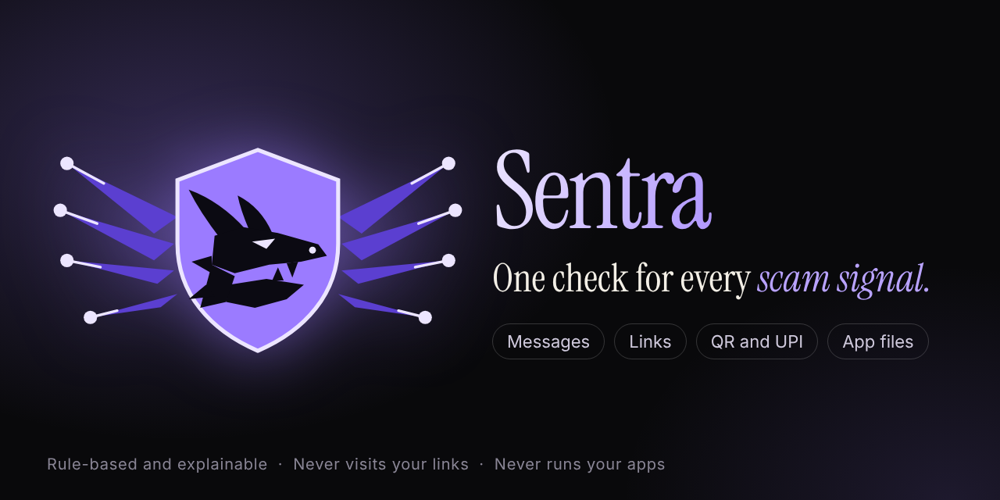

<p align="center"></p>

# Sentra

**One check for every scam signal.** Sentra reads a message, links, UPI/QR payloads and Android app files **together**,
shows exactly which warning signs it found, and replays how the scam would have unfolded. Built for INNOVEX 2026,
problem statement PS 05 (AI-Powered Cybersecurity).

**Live demo:** https://sentra-cgbb.onrender.com (press **Demo** in the dock). The free server may take up to a minute to wake.

> Sentra is a **rule-based, explainable detection engine**. It is not machine learning and it never says something is "safe".
> It never visits your links and never runs your apps.

## What it does
- **Message:** pressure, OTP requests, impersonation, threats, payment demands, job and family-impersonation lures.
- **Link:** lookalike and typo domains, brand in subdomain, punycode, raw IPs, `@` tricks, shorteners, app downloads,
  including bare domains such as `example.com`. Static only: no link is ever opened.
- **QR and UPI:** does the code send or receive money, who it says it pays, name-versus-ID mismatches. The QR is decoded in your browser.
- **App file (.apk):** SMS plus overlay, SMS interception, hidden payloads, debug certificates, official package IDs of known bank apps.
- **Full check:** combines everything into one verdict, because scams mix these.

## How it decides
Signals (strength x reliability) -> categories -> **scam scripts** (impersonation + urgency + credential theft, and so on)
-> capped reassuring signs -> a level from Low signals to Critical. The same input always gives the same score.
Details and a worked example: [docs/METHODOLOGY.md](docs/METHODOLOGY.md).

## Measured results
Run `python tools/benchmark.py` (main set) and `python tools/benchmark.py --holdout`.

| Test set | Scams flagged | Precision | False alarms |
|---|---|---|---|
| Main set, first run before tuning | 55 / 58 (94.8%) | 96.5% | 2 / 32 (6.2%) |
| Main set, after general fixes (used in development) | 58 / 58 | 100% | 0 / 32 |
| **Holdout, never tuned on** | **17 / 22 (77.3%)** | **94.4%** | **1 / 18 (5.6%)** |

The cases were written by the team, so this is **not independent real-world validation**. Known gaps: delivery OTPs that
are meant to be shared in person, investment scams with no warning words, brand-prefix domains. See
[docs/BENCHMARK.md](docs/BENCHMARK.md), [docs/HOLDOUT.md](docs/HOLDOUT.md) and [docs/JUDGE_QA.md](docs/JUDGE_QA.md).

## Run it locally
```
pip install -r requirements.txt
python -m uvicorn server:app --reload
```
Open http://127.0.0.1:8000

## Tests
```
pip install -r requirements-dev.txt
python -m pytest -q          # 70 tests: engine, analyzers, API security, robustness, benchmark guard
python tools/benchmark.py    # precision, recall, false-positive rate, F1
```

## Technologies
Python, FastAPI, Androguard (static app analysis), jsQR (in-browser QR decoding), plain HTML/CSS/JavaScript,
pytest, GitHub Actions, Render.

## Structure
`analyzers/` readers for messages, links and QR, app files | `engine/fusion.py` scoring | `data/` signals, scam scripts,
brands | `server.py` API with validation and rate limiting | `web/` interface and brand assets | `tests/` automated tests and
benchmark sets | `tools/` benchmark and image tools | `docs/` methodology, security, benchmark, judge Q&A, presentation.

## Security and privacy
Nothing is stored: messages are processed in memory, uploads are deleted right after reading, and the browser History keeps
only the result. Input limits, file-structure checks, rate limiting, generic errors and a content-security policy are
described and tested in [docs/SECURITY.md](docs/SECURITY.md).

## License
MIT
